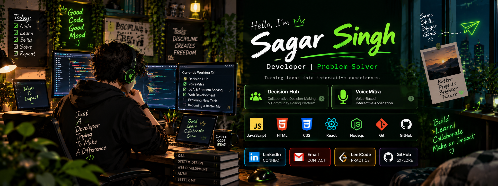

 

### `Building things, learning every day, and getting better with every project.`

---

## 👋 A Little About Me

Hey there! I'm **Sagar Singh**, a developer who enjoys turning ideas into working applications.

I like exploring new technologies, solving problems, and learning by building projects rather than just reading about them. Every project gives me a chance to improve, experiment, and try something new.

- 💻 I enjoy developing interactive applications.
- 🗳️ I'm interested in collaborative platforms and useful software.
- 🎙️ I enjoy exploring voice-based interactions.
- 🧠 I believe consistent practice matters more than perfection.
- 🌱 Always learning, experimenting, and improving.

> *I'm not trying to know everything. I'm trying to get a little better every day.*

---

## 🚀 Featured Projects

### 🗳️ 1. Decision Hub

**Collaborative Decision-Making & Community Polling Platform**

Decision Hub focuses on making group decisions more interactive by bringing collaborative decision-making and community polling together.

**Key highlights**
- 🗳️ Community polling and shared decision-making
- 👥 Collaborative participation
- 💡 A platform centered on collecting opinions and making group choices

**Tech:** JavaScript

[Explore Decision Hub →](https://github.com/Sagar-Singh24/DecisionHub-Collaborative-Decision-Making-Community-Polling-Platform-Team-B.git)

---

### 🎙️ 2. VoiceMitra

**Voice-Based Interactive Application**

VoiceMitra explores voice-based interaction and interactive application development. It represents my interest in building software that feels more natural and accessible to use.

**Key highlights**
- 🎤 Voice-oriented interaction
- ⚙️ Interactive application development
- 🛠️ Hands-on experience with JavaScript

**Tech:** JavaScript

[Explore VoiceMitra →](https://github.com/Sagar-Singh24/VoiceMitra)

---

## 🛠️ Tech Arsenal

### 💻 Languages

  

### 🎨 Frontend Development

  

### ⚙️ Backend Development

  

### 🗄️ Databases

  

### 🤖 AI & Machine Learning

  

### 🔧 Tools & Platforms

  

---

## 📊 GitHub Analytics

  

---

## 🎯 Current Mission

- [ ] Build more practical and meaningful projects.
- [ ] Strengthen problem-solving and programming fundamentals.
- [ ] Explore new tools and technologies.
- [ ] Improve code quality and software design.
- [ ] Learn through collaboration and open-source projects.

---

## 🧩 My Developer Philosophy

| 🌱 Learn | 💻 Build | 🔍 Improve |
|:---:|:---:|:---:|
| Stay curious | Turn ideas into code | Learn from mistakes |

### `Progress > Perfection`

I believe good developers aren't people who never get stuck. They're people who keep trying, ask questions, learn from mistakes, and find a way forward.

---

## 🤝 Let's Connect

I'm always happy to explore interesting projects, learn new things, and connect with fellow developers.

 

### 💚 Keep learning. Keep building. Keep growing.

**Thanks for stopping by!**

